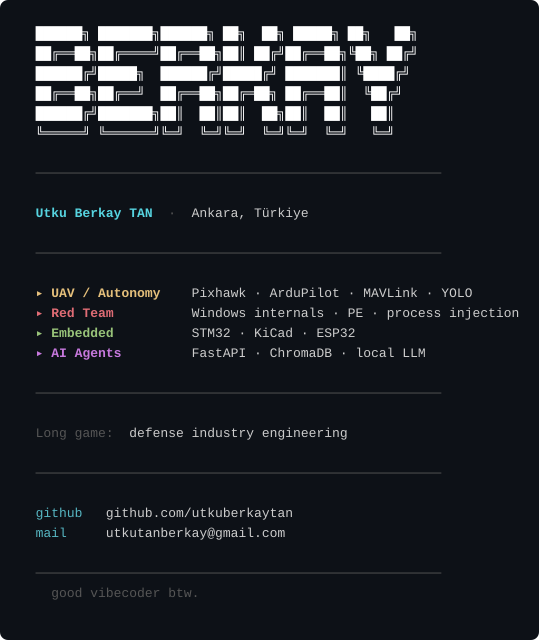

  

  <code>curl -sL https://raw.githubusercontent.com/utkuberkaytan/utkuberkaytan/main/card.txt</code>

---

### Selected work

| Project | What it does | Stack |
|---|---|---|
| **[TEAM_BERKUT-OPENSOURCE](https://github.com/utkuberkaytan/TEAM_BERKUT-OPENSOURCE)** | Open-source codebase from Team Berkut — autonomous UAV competition stack including mission planning, telemetry handling, and computer vision. | `Python` `MAVLink` `YOLO` |
| **[usb-lisance-lock](https://github.com/utkuberkaytan/usb-lisance-lock)** | Hardware-bound software licensing — RSA-signed licenses tied to a USB device serial, so a key only works on the physical stick it was issued for. | `C#` `.NET` `RSA` |
| **[PassSmith](https://github.com/utkuberkaytan/PassSmith)** | Lightweight wordlist generator for pentesting and password auditing. Feed it keywords, it builds realistic candidate passwords. | `C` |
| **[xor_enc_to_arraykey](https://github.com/utkuberkaytan/xor_enc_to_arraykey)** | XOR encryption utility that encodes payloads into obfuscated array-key format — useful for shellcode staging and AV evasion research. | `C` |
| **[file_pumper](https://github.com/utkuberkaytan/file_pumper)** | Inflates a file to an arbitrary size with junk data — useful for testing size-based AV/EDR bypasses and upload filters. | `Python` |
| **[dualsense-toolkit](https://github.com/utkuberkaytan/dualsense-toolkit)** | USB control panel and CLI for the Sony DualSense on Windows — haptics, lightbar, triggers, straight over the wire. | `Python` `USB HID` |
| **[xinput-toolkit](https://github.com/utkuberkaytan/xinput-toolkit)** | Xbox controller control panel for Windows built directly on the XInput API. No third-party dependencies. | `Python` `XInput` |

More in <a href="https://github.com/utkuberkaytan?tab=repositories">repositories</a> — including private UAV, AI, and red-team work.

---

### Toolbox

  
  
  
  

  
  
  
  
  
  

  
  
  
  
  

  
  

